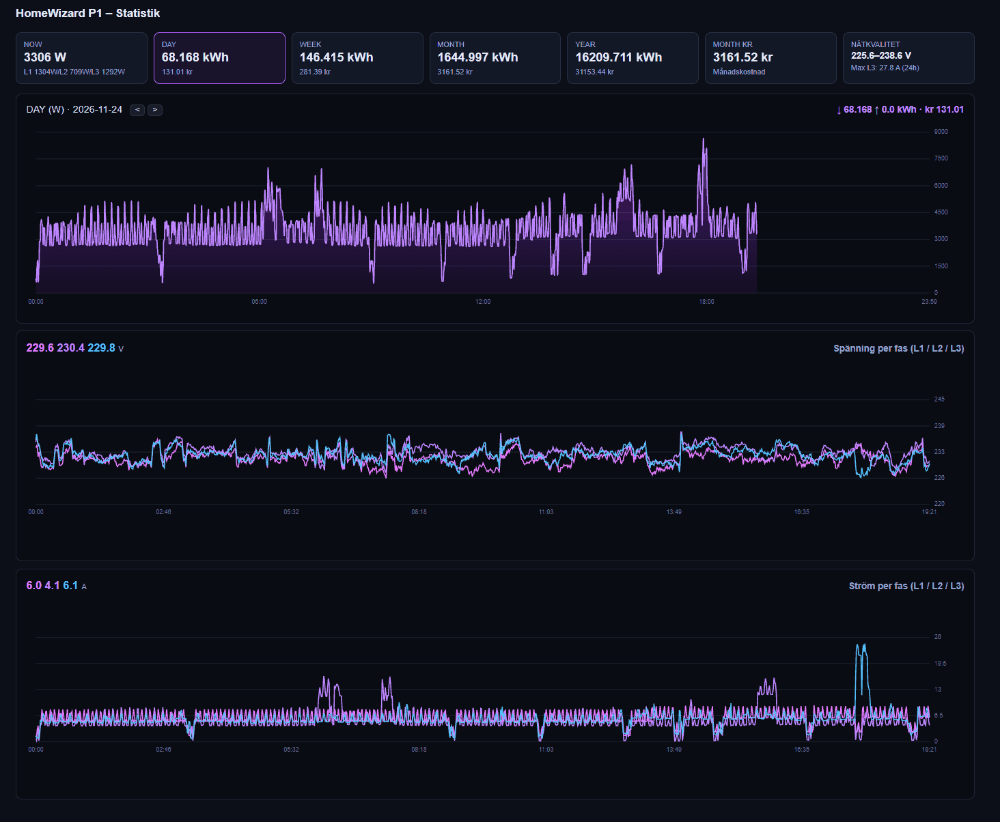
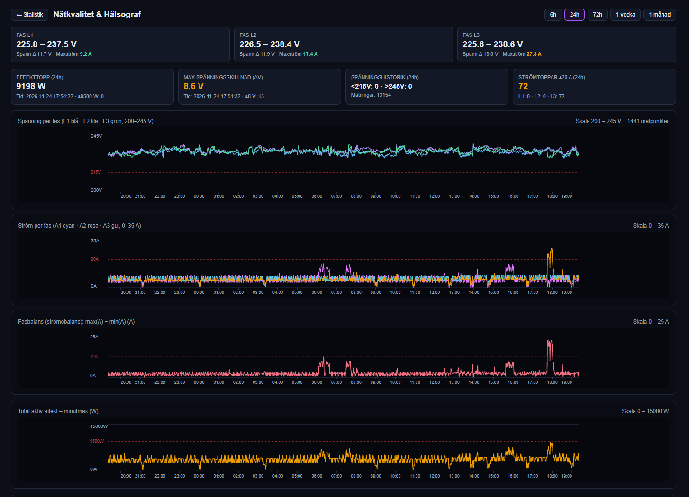

# HomeWizard P1 Logger & Dashboard

HomeWizard P1 reads a local HomeWizard P1 meter (Local API v1) every 10 seconds. It stores each reading in SQLite. It watches
the phases and the voltage, sends alarms through Signal, and shows statistics and power quality in a web page.

It uses the Python 3 standard library only. Nothing to install with `pip`.

> **Built with AI assistance.** Google Gemini helped to create the first version of this program. Claude (Anthropic) helped to
> clean it up, test it, fix problems that a review found, package it for Docker and write the documentation. The owner decides what
> the program does, adjusts the installation and runs it on their own network. See
> [AI assistance](AGENTS.md#ai-assistance) for who did what and how the result is checked.

## What it looks like

Screenshots from a live install. They were taken from an earlier version with Swedish labels. The labels in this repository
are English. The page and card layout is the same.



The statistics page (`/`). The cards at the top choose the period. The chart shows the power of one day, with the voltage and
the current of each phase below it.



The power quality page (`/power-quality`). It shows the voltage range and the current peaks of each phase over the chosen
window. See [`docs/ARCHITECTURE.md`](docs/ARCHITECTURE.md#pages) for every card and chart.

## Install

On a Debian host, as root, from the unpacked repository:

```sh
sh install/install.sh
```

Then edit `/opt/homewizard/.env`. Set `HW_METER_URL` to the address of your meter. Set the three `HW_SIGNAL_*` values if you want
Signal messages. Start the services:

```sh
systemctl enable homewizard-collector.service homewizard-api.service
systemctl restart homewizard-collector.service homewizard-api.service
```

The script enables and restarts the services itself when `HW_METER_URL` is already changed. It never replaces an existing `.env`.
Run it again for an update.

## Run with Docker

One line sets it up on a Raspberry Pi (64-bit Raspberry Pi OS), Ubuntu or Debian machine on your own network. You do not
download the repository. The line installs Docker when it is missing (it asks for your password with `sudo`), downloads the
published image, asks for the address of the meter and starts the program:

```sh
curl -fsSL https://github.com/rnauser1986/HomeWizard-P1-Monitor/releases/latest/download/install.sh | sh
```

At the end it shows the address to open. Run the line again to update: it takes the newest image and keeps `.env` and the
database. To remove the program add `--uninstall`: `... | sh -s -- --uninstall`. The database stays in the Docker volume, and
installing again takes it back. `--uninstall --delete-data` deletes it too. Never open the web port to the internet: the page has
no sign-in.

The line works only when a release exists (the Release workflow makes it, see "Release" in
[`docs/ARCHITECTURE.md`](docs/ARCHITECTURE.md#run-with-docker)) and when the repository and the image package are public.
Read a script before you run it from the internet: [`install/get.sh`](install/get.sh) is short.

If you already have the repository, the setup script does the same and builds the image on your machine. It asks for what the
program needs (the address of the meter, the web port and, if you want, the Signal values), writes `.env` and starts the containers:

```sh
sh install/docker-setup.sh
```

Open `http://<host>:8085/`. To do it by hand, copy `.env.example` to `.env`, set `HW_METER_URL` and run
`docker compose up -d --build`. The database is in the Docker volume `data` and stays when you update. See "Run with Docker" in
[`docs/ARCHITECTURE.md`](docs/ARCHITECTURE.md#run-with-docker) for the backup, the update and how to move a host install.

## Move an older install

An older install has the meter address and the Signal values inside `collector.py` and `notify_signal.py`. Run this first, then
`install.sh`:

```sh
sh install/migrate-from-old-layout.sh
sh install/install.sh
```

The first script archives the old files, writes `/opt/homewizard/.env` from the old values and prints the command to go back.
See "Move an older install to this layout" in [`docs/ARCHITECTURE.md`](docs/ARCHITECTURE.md#operations).

## Check that it works

- Open `http://<host>:8085/` for the statistics.
- Open `http://<host>:8085/power-quality` for the power quality.
- Open `http://<host>:8085/health`. The answer `{"ok": true, "status": "ok", ...}` means new measurements arrive.

The program has no sign-in. Use it on the home network only, or through a VPN. Never open a port to the internet.

## Files

| File | Job |
| --- | --- |
| `config.py`, `.env.example` | Settings. Copy `.env.example` to `.env`. |
| `collector.py` | Creates the database, polls the meter, runs the alarms. |
| `alarm_*.py`, `notify_signal.py` | The alarms and the Signal messages. |
| `api_server.py`, `ui.html` | The web and API server and the statistics page. |
| `pq_data.py`, `pq_page.py`, `pq_route.py` | Power quality. `pq_route.py` is optional and needs Flask. |
| `tariff_mod.py` | Price per kWh, fixed or spot price (`SE1` to `SE4`). |
| `Dockerfile`, `docker-compose.yml` | The image and the two services for Docker. |
| `.github/workflows/` | The tests (`build.yml`) and the release of the image and the install line (`release.yml`). |
| `install/` | The install script, the one-line Docker install (`get.sh`) and `compose.release.yml`, the Docker setup script, the script that moves an older install, the systemd units and the backup script. |
| `tests/` | The tests. |

## Tests

```sh
python3 -m unittest discover -s tests -t . -v
```

The GitHub workflow also runs the linter (`ruff check .`) and starts the Docker package against a fake meter
(`sh tests/e2e/run.sh`). You can run the second check yourself if you have Docker.

## More

- [`docs/ARCHITECTURE.md`](docs/ARCHITECTURE.md): how the program is built, every setting, the backup and the known gaps.
- [`AGENTS.md`](AGENTS.md): the rules for a change, for people and for agents.
