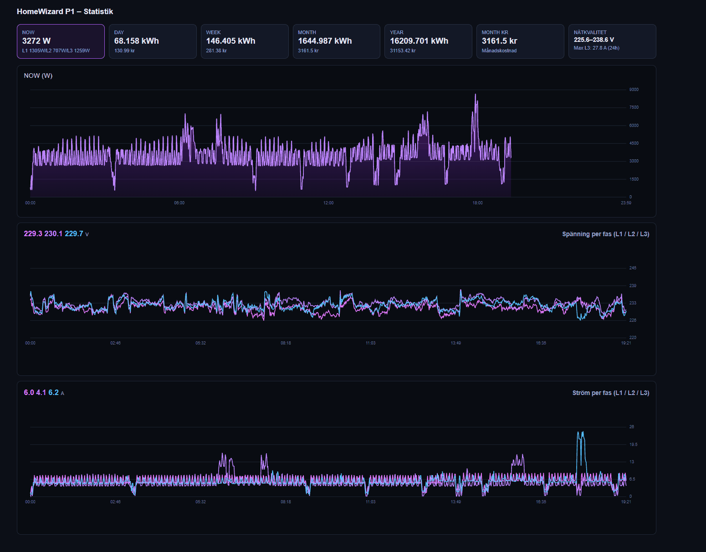
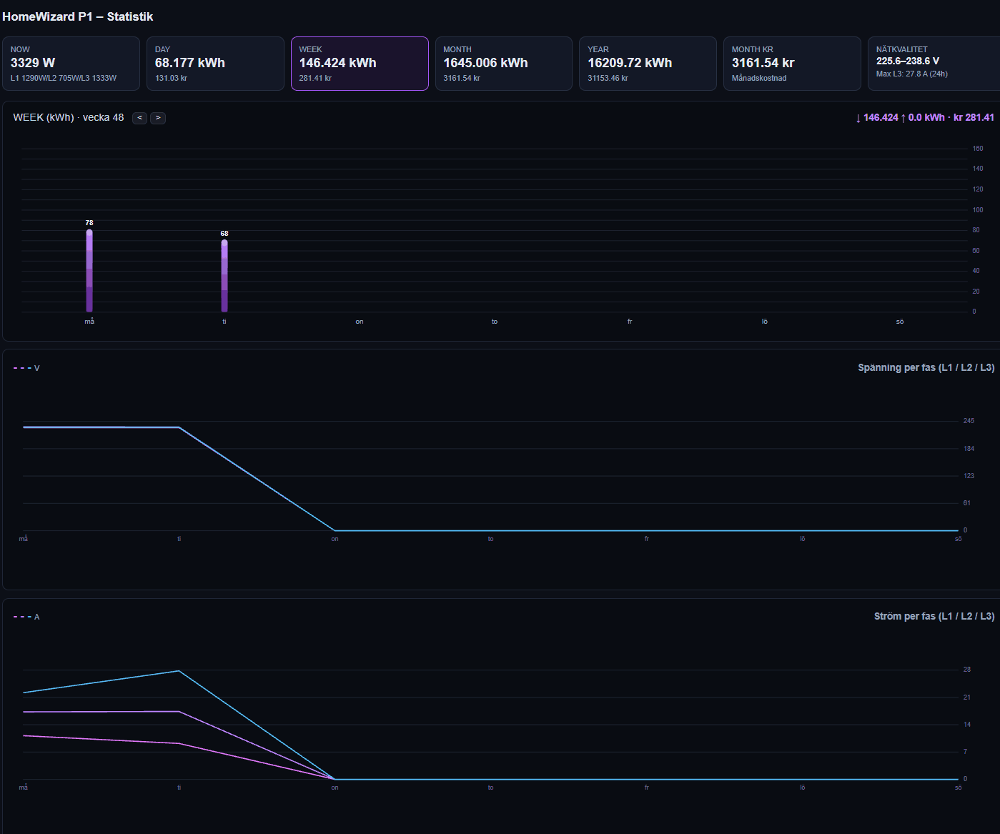
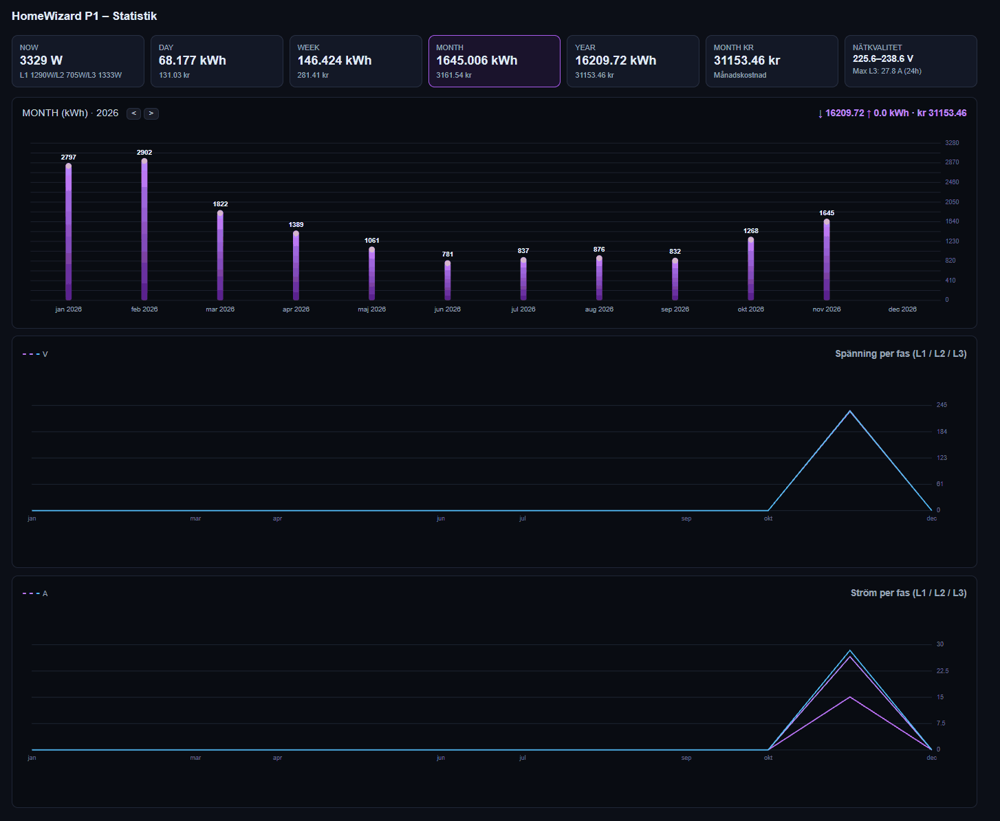
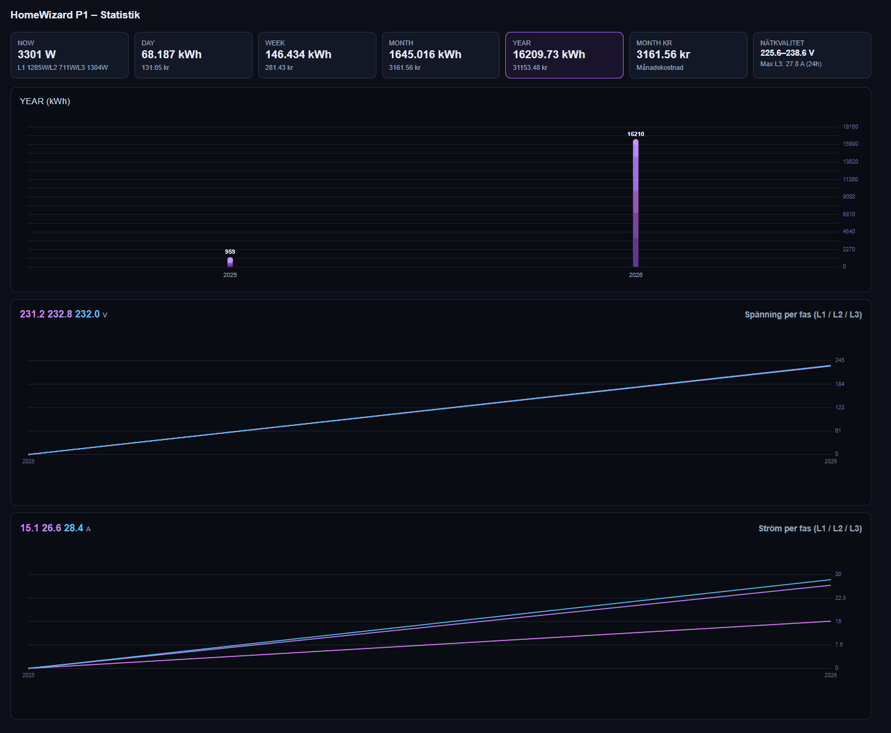
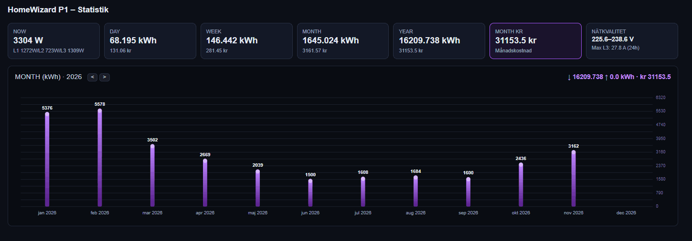
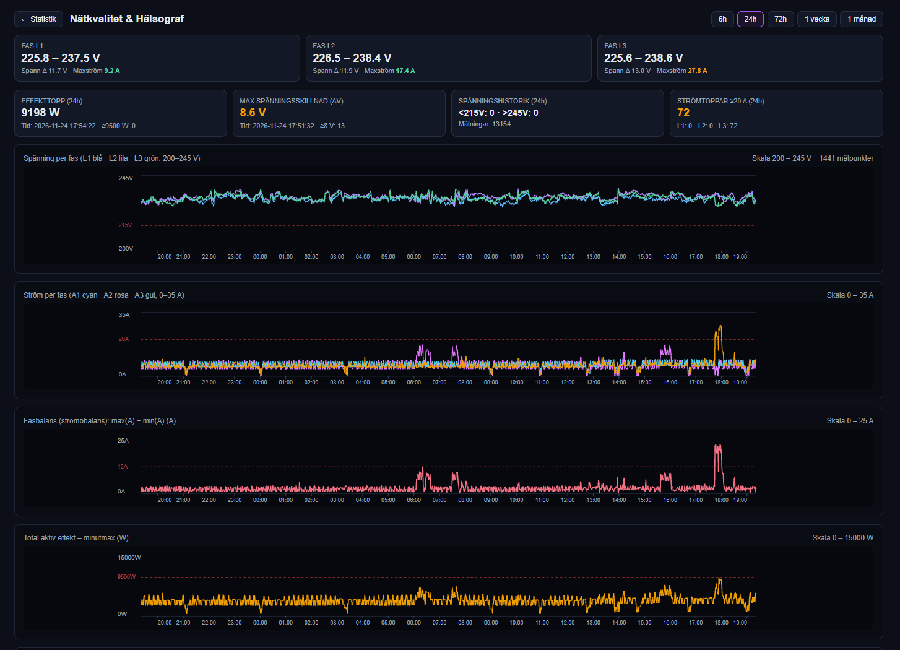
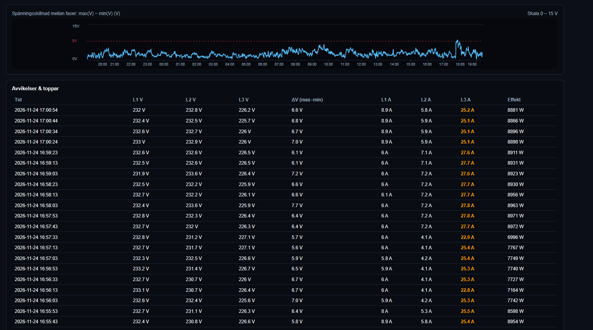

# HomeWizard P1 – architecture and operations

This file tells how HomeWizard P1 is built and what it does. It replaces the earlier Word documents
(`HomeWizard_P1_PQ_Monitoring_Documentation_EN` and `_SWE`). `AGENTS.md` lists the rules for a change. This file gives the
detail behind each rule. Write changes to this file by the rules in `.agents/writing.md`.

## Contents

- [Architecture](#architecture)
- [Data model (SQLite)](#data-model-sqlite)
- [Collector](#collector)
- [Alarms](#alarms)
- [Price and tariff](#price-and-tariff)
- [Web server and routes](#web-server-and-routes)
- [Power quality](#power-quality)
- [Pages](#pages)
- [Design tokens](#design-tokens)
- [Configuration (.env)](#configuration-env)
- [Operations](#operations)
- [Run with Docker](#run-with-docker)
- [Known gaps](#known-gaps)

## Architecture

The program uses the Python 3 standard library only (`sqlite3`, `urllib.request`, `http.server`, `json`). It has two
processes.

| Process | File | Job |
| --- | --- | --- |
| Collector | `collector.py` | Reads the meter, writes to SQLite, runs the alarms. |
| Web server | `api_server.py` | Reads SQLite, serves the pages and the JSON routes. |

The two processes share one SQLite file in WAL mode. The collector writes and the web server reads, so they do not block each
other.

**Data flow**

1. `config.py` reads `.env` and the environment. Every other module imports its settings from `config.py`.
2. `collector.py` sends an HTTP GET to the meter (Local API v1, JSON) every `HW_POLL_INTERVAL_SEC` seconds.
3. The collector writes the reading to `measurements`, updates the minute row of the reading in `measurements_minute`, then calls the alarm modules.
4. The alarm modules send messages through `notify_signal.py` (Signal, optional) and write tagged lines to standard output.
5. `api_server.py` answers page and JSON requests from the database. `tariff_mod.py` gives the price per kWh.
6. `pq_data.py` and `pq_page.py` give the power quality numbers and page.

**Rules**

- The program only reads from the meter. It never writes to it.
- The program has **no sign-in**. Reach it only on the home network, or through a VPN or an access service such as Tailscale or
  Cloudflare. Never open a port to the internet.
- The web server listens on `HW_API_HOST:HW_API_PORT` (default `0.0.0.0:8085`). Set `HW_API_HOST` to the address of one network
  interface when the host has more than one.
- Nothing that belongs to one installation is in the repository: not the meter address, not the Signal numbers, not `.env`.
- Every setting has a default in `config.py`, and no default belongs to one installation. Without `.env` the program uses the
  example meter address and sends no Signal message. The collector says so in the log (`[CONFIG]`).

## Data model (SQLite)

`collector.py` creates the database at the first start (`init_db`). The default file is `/opt/homewizard/homewizard.db`. Put it on
fast local storage. WAL does not work well on a network mount.

| Table | Columns | Purpose |
| --- | --- | --- |
| `measurements` | `id`, `ts_utc`, `wifi_strength`, `active_power_w`, `active_power_l1_w` to `l3_w`, `active_voltage_l1_v` to `l3_v`, `active_current_a`, `active_current_l1_a` to `l3_a`, `total_power_import_kwh`, `total_power_export_kwh`, `raw_json` | One row for each poll. Index `idx_measurements_ts` on `ts_utc` and `idx_measurements_power` on `active_power_w`. |
| `historical_kwh` | `period_type` (`day`, `week`, `month`, `year`), `period_key`, `kwh` | Energy from before the live polling started. The web server adds it to the live totals. |
| `tariff_config` | `id` (always 1), `start_date`, `mode` (`fixed`, `dynamic`), `interval_min` (15, 60), `area`, `fixed_sek`, `add_sek`, `vat_pct` | The price settings. An empty table means the defaults from `.env`. |
| `spot_prices` | `slot_key` (`YYYY-MM-DD HH:MM`), `sek_per_kwh` | A cache of the spot prices (`elprisetjustnu.se` for the Swedish zones). See [Price and tariff](#price-and-tariff). |
| `measurements_minute` | `minute_utc` (`YYYY-MM-DDTHH:MM:00`), `n`, the lowest and highest voltage and the highest current of each phase, the highest power and spread between phases with the time of each, the sums and counts for the average voltages, and the counts of samples over each limit | One row for each minute, made from `measurements`. The power quality page reads it. See Power quality. |
| `measurements_minute_meta` | `key`, `value` | The power and spread limits the counts in `measurements_minute` were made for. |

**Rules**

- **The program never changes or deletes a measurement.** Each poll adds one row. `raw_json` holds the full answer of the meter.
  The one exception is the format of an old `ts_utc`, described below. `measurements_minute` is made from the measurements and can be built again at any time.
- Every column of `measurements` except `ts_utc` and `raw_json` can be NULL. The meter leaves out fields it does not have.
- `ts_utc` is a UTC time in ISO 8601 text, for example `2026-11-24T06:11:14.123456+00:00`. The pages show local time. SQLite
  converts with `'localtime'`, so the host must have the right time zone.
- A row imported from CSV has `"source":"csv_import"` in `raw_json`. The kWh totals skip these rows. Their energy comes from
  `historical_kwh`. An imported row must have `ts_utc` in the same text format as a polled row (`YYYY-MM-DDTHH:MM:SS...`), because
  the queries compare `ts_utc` as text. At every start the collector rewrites a `ts_utc` without a `T` (for example `2026-11-19 19:15:00`) to the polled format `2026-11-19T19:15:00+00:00`, so an import with the wrong format is repaired.

**Queries and performance**

- **A period is a range on `ts_utc`.** `api_server.py` finds the UTC bounds of a local day, week, month or year with `day_bounds()`
  and filters with `RANGE` (`ts_utc >= ? AND ts_utc < ?`). SQLite then uses `idx_measurements_ts`. A filter such as
  `date(ts_utc,'localtime')=...` cannot use the index and reads the whole table. Tests check that both give the same rows, also on
  the days that summer time changes.
- **The standby power** is the 15th percentile of the positive power values. SQLite finds it with `COUNT(*)` and `OFFSET`, with
  `idx_measurements_power`. No list of values is built in Python.
- **Measured** on a made-up database with 1.05 million rows (about four months of polls at 10 s), warm cache, one core of a cloud
  server. A small home server is slower. Before the change and after it:

| View | Before | After |
| --- | --- | --- |
| `stats()` | 3.2 s | 0.7 s |
| `history` now / day / week | 1.1 s / 1.9 s / 2.3 s | 0.03 s / 0.03 s / 0.05 s |
| `history` month / year | 4.9 s / 3.6 s | 3.7 s / 2.4 s |

- **The month and year views still read every row of the year.** They sum, average and group a whole year, so their time grows with
  the number of rows. See Known gaps.
- **The database grows.** Each row holds the full `raw_json` (about 750 bytes in the test), so four months were 1.1 GB, about 3 GB
  for a year. The program deletes nothing. See Known gaps.
- **Energy for a period** is `MAX(total_power_import_kwh) - MIN(total_power_import_kwh)` over the live rows of the period, plus
  the matching `historical_kwh` values. The program does not count exported energy.
- **Standby load** is the 15th percentile of the positive power values of the period. The standby kWh is that power times the
  hours. For day and now, one point is one minute. For week, month and year, one row is one poll, so the hours are the number of
  rows times `HW_POLL_INTERVAL_SEC` divided by 3600.

The price settings and how to change them are in [Price and tariff](#price-and-tariff).

## Collector

`collector.py` runs one loop under `homewizard-collector.service`.

1. Read the meter URL. The timeout is `HW_METER_TIMEOUT_SEC` (6 s).
2. Add the reading to `measurements` with a UTC time stamp and the full answer in `raw_json`.
3. Make the row of that minute in `measurements_minute` again from the samples of the minute (a few rows). An error here is logged
   as `[MINUTE]` and never stops the collector or the alarms: the page then counts from the samples.
4. Call `check_spike`, `check_imbalance`, `check_phase_amp`, `check_voltage` and `check_stale`.
5. Sleep `HW_POLL_INTERVAL_SEC` seconds.

At the start, before the loop, `sync_minutes` makes the minute table and fills it from `measurements` when it is empty, behind the
samples or made for other limits. With 100 000 samples this takes about a second.

**Rules**

- **A failed poll never stops the collector.** The loop catches every exception, prints `[POLL_ERR] ...`, runs `check_stale` and
  tries again after the sleep.
- **The collector closes the database when it stops.** It keeps one connection for its whole life. `main()` closes it in `finally`,
  and a `SIGTERM` handler (the signal that systemd and Docker send) turns the stop into a normal exit, so `finally` runs. Without the
  handler, Python ends at once on `SIGTERM`, and in a container the stop waits 10 seconds and then kills the program.
- At the start the collector prints a `[CONFIG]` line when Signal is not set up, and one when `HW_METER_URL` is still the example
  address. A silent alarm is worse than a loud one.
- An exception in an alarm module ends that loop pass in the same way. Keep alarm modules free of exceptions.
- `check_stale` reads the database. It is the only alarm that works when the meter is silent.

## Alarms

Each alarm module keeps its state in memory: a counter of samples in a row (`NEED`), the time of the last alert and the
extreme value of the current series. A restart clears the state. Samples in a row filter out a short start surge, for example
a heat pump compressor.

| Module and function | Trigger | Output | Cooldown |
| --- | --- | --- | --- |
| `alarm_imbalance.py` `check_imbalance(l1, l2, l3)` | `max - min` of the three phase currents is at least `HW_ALARM_IMBALANCE_DIFF_A` (12 A) for 6 samples in a row | Signal and log `[IMBALANCE]` | 1200 s |
| `alarm_phase_amp.py` `check_phase_amp(l1, l2, l3)` | One phase current is at least `HW_ALARM_PHASE_LIMIT_A` (20 A) for 3 samples in a row | Signal and log `[PHASE_AMP]` | 1800 s for each phase |
| `alarm_voltage.py` `check_voltage(v1, v2, v3)` | A phase voltage is below `HW_ALARM_VOLTAGE_LOW_V` (215 V) or above `HW_ALARM_VOLTAGE_HIGH_V` (245 V) for 3 samples in a row | Signal and log `[VOLTAGE_LOW]` or `[VOLTAGE_HIGH]` | 1800 s for each phase and direction |
| `alarm_spike.py` `check_spike(l1, l2, l3)` | The highest phase current is at least `HW_ALARM_SPIKE_LIMIT_A` (22 A) for 3 samples in a row | Signal and log `[SPIKE]` | 1200 s |
| `alarm_stale.py` `check_stale(db_path)` | The newest `ts_utc` is older than `HW_ALARM_STALE_SEC` (300 s) | Signal and log `[STALE]`. When data returns: Signal and log `[STALE_OK]` | 1200 s |

`notify_signal.py` `send_signal(msg)` always prints `[SIGNAL_MSG] ...`. It sends an HTTP POST (JSON) to
`<HW_SIGNAL_URL>/v2/send` only when `HW_SIGNAL_URL`, `HW_SIGNAL_FROM` and `HW_SIGNAL_TO` are all set. The timeout is
`HW_SIGNAL_TIMEOUT` (4 s). It does not send the same text twice inside `HW_SIGNAL_COOLDOWN` (30 s), and it forgets older texts so
its memory stays small. It catches every exception and prints `[SIGNAL_ERR] ...`.

**Rules**

- A threshold hit counts when the value is at or beyond the limit. The voltage alarm uses `<` and `>`, so a value exactly on the
  limit is normal.
- A missing value (`None`) never counts as a hit. In `check_phase_amp` and `check_voltage` it sets the counter back to zero.
  `check_imbalance` and `check_spike` skip the sample when a value is missing.
- A normal sample sets the counter back to zero.
- A current of 22 A or more can send a phase alert (20 A) and a spike alert (22 A) for the same event.
- The stale alarm reads the database, so it works when the meter is silent. An error inside it is logged as `[STALE_ERR]`.
- An alert resets the extreme value. The next alert shows the extreme of its own series.
- The message holds the limit, the value now, the extreme value and all three phases.
- **Never log the Signal numbers or the Signal URL.**

## Price and tariff

The pages show a cost in SEK next to the energy. The cost is the energy of the period times a price per kWh. `tariff_mod.py`
gives that price with `effective_rate(cur, db_path)`. There are two modes:

| Mode | The price per kWh |
| --- | --- |
| `fixed` (the default) | The same all the time: `fixed_sek`. Use it for a contract with a fixed price, or when you do not want spot prices. |
| `dynamic` | The spot price (the market price) of the current hour or quarter of an hour. Use it for a contract that follows the market. |

Both modes add a surcharge and VAT: the price is `(base + add_sek) * (1 + vat_pct / 100)`. In `fixed` mode `base` is `fixed_sek`.
For example, `fixed_sek` 1.50, `add_sek` 0.08 and `vat_pct` 25 give 1.975 SEK per kWh. In `dynamic` mode a spot price of 0.50 with
the same surcharge and VAT gives 0.725.

**The settings** are row 1 of the table `tariff_config`. Without that row the program uses the defaults below, which means mode
`fixed`. Only some of the settings can be set in `.env`. The others are written to the table.

| Column | `.env` default | Meaning |
| --- | --- | --- |
| `mode` | | `fixed` or `dynamic`. Without a row: `fixed`. |
| `fixed_sek` | `HW_DEFAULT_FIXED_SEK` (1.5) | The fixed price per kWh, before surcharge and VAT. It is also the price when a spot price is missing. |
| `add_sek` | | A surcharge per kWh before VAT, for example the margin of the supplier. Without a row: 0. |
| `vat_pct` | | VAT in percent. Without a row: 25. |
| `start_date` | `HW_TARIFF_START_DATE` (2026-11-01) | The days before this date always use the fixed price, also in `dynamic` mode. |
| `area` | `HW_PRICE_AREA` (SE3) | The zone that the program asks the price service for. `SE1` to `SE4` for the service below. |
| `interval_min` | | 60 or 15: the length of the slot that the program looks up. Without a row: 60. |

**Switch mode.** The server reads the row on every request, so there is no need to restart. On a host install:

```sh
sqlite3 /opt/homewizard/homewizard.db \
  "INSERT OR REPLACE INTO tariff_config (id, start_date, mode, interval_min, area, fixed_sek, add_sek, vat_pct) \
   VALUES (1, '2026-11-01', 'dynamic', 60, 'SE3', 1.50, 0.08, 25.0);"
```

With Docker the image has no `sqlite3` program, so use Python in the collector container:

```sh
docker compose exec -T collector python - <<'EOF'
import sqlite3
c = sqlite3.connect("/data/homewizard.db")
c.execute("INSERT OR REPLACE INTO tariff_config (id, start_date, mode, interval_min, area, fixed_sek, add_sek, vat_pct) "
          "VALUES (1, '2026-11-01', 'dynamic', 60, 'SE3', 1.50, 0.08, 25.0)")
c.commit()
EOF
```

To go back to the fixed price, write `'fixed'` in the same statement, or run
`UPDATE tariff_config SET mode = 'fixed' WHERE id = 1;`.

**How `dynamic` works**

- The module reads the price of the current slot from the table `spot_prices` (60 or 15 minutes, see `interval_min`). It takes
  the newest price at or before the slot. A price older than `HW_TARIFF_MAX_SLOT_AGE_HOURS` (36 h) does not count.
- If it finds no price, it fetches the prices of today and tomorrow from `https://www.elprisetjustnu.se/api/v1/prices/` for the
  zone in `area`, and tries again. It fetches at most once in `HW_TARIFF_SYNC_COOLDOWN` seconds (300 s). The service returns a
  price for every quarter of an hour (96 a day). With `interval_min` 60 the program uses the price of the first quarter of the
  hour, with 15 it uses the price of the quarter.
- The request names the program (`User-Agent: HomeWizard-P1-Monitor`): the service answers 403 to the default Python name. A
  failed fetch is logged as `[SPOT_ERR]`. The prices of tomorrow are not there before the afternoon, so one `[SPOT_ERR]` line
  with 404 for tomorrow is normal.
- If there is still no spot price, the price falls back to `fixed_sek`.
- The cost on the pages is the energy of the **whole period** times the **current** price. It is not a sum of the real price of
  each hour. With `fixed` this is exact. With `dynamic` every cost on the pages (day, week, month and year) changes when the
  price of the slot changes, so read it as a guide and not as an invoice. If your contract is priced on the monthly average, the
  current spot price is only a rough guide to it.

**Use a price service outside Sweden**

`elprisetjustnu.se` covers the four Swedish zones only. There are three ways to use the program elsewhere, from the least to the
most work:

1. **Use `fixed`.** No code. Set `fixed_sek` to your price, and change it by hand when the price changes:
   `UPDATE tariff_config SET fixed_sek = 0.95 WHERE id = 1;`.
2. **Fill `spot_prices` yourself.** No change of the program. Run a script (for example from cron, once a day when the prices of
   tomorrow are out) that writes one row for each slot, in the format below. The program only reads the table. When a slot has no
   row, it still asks the Swedish service, logs `[SPOT_ERR]` and uses `fixed_sek` for that slot, so keep the table filled ahead.
3. **Replace the fetch.** Change the function `fetch_day_spots(db_path, area, day_str)` in `tariff_mod.py`. `sync_spots` calls it
   for today and tomorrow, at most once in `HW_TARIFF_SYNC_COOLDOWN` seconds. `day_str` is the local day, `YYYY-MM-DD`, and
   `area` is the value in `tariff_config`, so write your own zone code there (for example `NO1`). A skeleton:

```python
def fetch_day_spots(db_path, area, day_str):
    """Store the prices of one local day. Never raise."""
    url = f"https://prices.example/{area}/{day_str}.json"  # your service
    req = urllib.request.Request(url, headers={"User-Agent": USER_AGENT})
    try:
        with urllib.request.urlopen(req, timeout=6) as resp:
            items = json.loads(resp.read().decode())
    except Exception as e:
        print(f"[SPOT_ERR] {day_str} {area}: {type(e).__name__}: {e}", flush=True)
        return
    c = sqlite3.connect(db_path, timeout=10.0)
    try:
        for it in items:
            slot_key = ...  # "YYYY-MM-DD HH:MM": the local time at the start of the slot
            price = ...     # per kWh, before add_sek and VAT, in the currency you want to show
            c.execute("INSERT OR REPLACE INTO spot_prices(slot_key, sek_per_kwh) VALUES(?,?)", (slot_key, float(price)))
        c.commit()
    finally:
        c.close()
```

The rules of the contract, for the second and third way:

- **One row for each slot:** `slot_key` is `YYYY-MM-DD HH:MM` in the **local time of the host** (the lookup uses SQLite
  `'localtime'`, so set the time zone of the host). The minutes are `00` for `interval_min` 60, and `00`, `15`, `30` and `45` for 15.
  `sek_per_kwh` is a price per **kWh**. Many services give a price per MWh: divide by 1000.
- **The currency is a label.** The column and the pages say SEK, but the number is shown as it is. To show another currency, change
  the text `SEK` in `ui.html`.
- **The function never raises** and logs `[SPOT_ERR]` with the day, the area and the kind of error. It must not log the text of
  an answer that holds anything private. Use only the standard library (`urllib`), as the rest of the program does.
- **The price service needs a way out.** A firewall or a router rule that blocks outgoing traffic must allow the new host.
- **Test it** with a copy of the class `FetchTests` in `tests/test_tariff.py`. The tests replace `urllib.request.urlopen`, so they
  need no network.

## Web server and routes

`api_server.py` starts a `ThreadingHTTPServer`. It answers GET requests only.

| Route | Answer |
| --- | --- |
| `/` | `ui.html`, the statistics page |
| `/stats` | JSON: power now (total, L1, L2, L3), and kWh and SEK for day, week, month and year |
| `/history?period=<now\|day\|week\|month\|year>&offset=<0\|-1\|...>` | JSON: the chart points, the phase voltage and current, and the standby load |
| `/power-quality` | The power quality page (`PQ_HTML`) |
| `/api/power-quality?hours=<1..HW_PQ_MAX_HOURS>` | JSON from `pq_data.py` |
| `/api/power-quality?hours=<1..HW_PQ_MAX_HOURS>&part=summary` | Only the summary (lowest and highest voltage, highest current of each phase), for the statistics page. It skips the series and the events and is much cheaper. |
| `/health` | JSON with `ok`, `status`, `latest_utc`, `age_sec`, `max_age_sec` |
| any other path | 404 with an empty body |

`/health` answers 200 when the newest measurement is not older than `HW_HEALTH_MAX_AGE_SEC` (120 s). It answers 503 with
`stale_data`, `no_data` or `db_error`. For `db_error` the body holds no details. They go to the log as `[HEALTH_ERR]`. Use it with
Uptime Kuma or a similar monitor.

**Rules**

- Every route is open. Reach the server only through the home network or an access service (see Architecture).
- Bound every input from a request. `hours` is 1 to `HW_PQ_MAX_HOURS` (720 by default). `offset` is a whole number and the server
  limits it to a safe range.
  A bad value gives the default, not an error.
- An unexpected error in a route gives HTTP 500 with the body `{"error":"internal error"}` and the log line `[HTTP_ERR] <path>: ...`.
  The body never holds details.
- Use `?` placeholders for every value from a request.
- A client has 15 seconds (`H.timeout`) to send its request. A slower client is dropped.
- Every answer has `X-Content-Type-Options: nosniff` and `Referrer-Policy: no-referrer`.
- The server logs the answers with status 400 or higher as `[HTTP] <method> <path> -> <status>`, without the query. It logs a
  successful answer never. At the start, each program logs one `[START]` line with its settings. The line holds no address and no
  number.
- `SIGTERM` (the signal of systemd and Docker) stops the server with exit code 0, and it closes its socket.

## Power quality

`pq_data.py` `get_power_quality(db_path, hours)` analyses the last 1 to 720 hours. The default is 24. It keeps each answer in
memory for `HW_PQ_CACHE_TTL_SEC` seconds for each combination of file and hours. The web server asks for at most `HW_PQ_MAX_HOURS`
hours (720 by default, one month).

The bucket size grows with the window:

| Window | Bucket |
| --- | --- |
| up to 24 h | 1 minute |
| up to 72 h | 5 minutes |
| up to 7 days | 15 minutes |
| up to 30 days | 60 minutes |

The answer holds:

- `summary`: the minimum and maximum voltage and the maximum current for each phase, the peak power and the largest voltage
  spread **ΔV** (`max(V) - min(V)`), with the time of each peak.
- `aggregates`: the number of samples, the counts of voltages below 215 V and above 245 V, the counts of currents at or above 20 A,
  and the counts above `HW_PQ_POWER_PEAK_W` and `HW_PQ_DV_WARN_V`.
- `series`: one point for each bucket (average voltage, maximum current, maximum power, maximum ΔV).
- `events`: up to 1000 anomaly rows, newest first.

The cut-off of the window is written as `YYYY-MM-DDTHH:MM:SS` text, the same format as `ts_utc`.

**The minute table.** Counting six times over every sample of a month is slow (1 to 2 s for 30 days of samples every 10 s), and it
grows with the data. So the page reads `measurements_minute`: one row for each minute with the extremes, the sums for the averages
and the counts over each limit. 30 days are 43 200 rows, a sixth of the samples at one every 10 s (in the test 0.16 s against 1.0 s, and 0.04 s against 0.41 s for 7 days),
and it does not grow when the poll interval gets shorter. The page asks the table when `minutes_ready` says it is in order (it exists, it was made for the limits in
use and it has the minute of the newest sample). Otherwise it counts from the samples, as `compute_from_rows` does, so a missing or
old table never gives a wrong answer. The two ways must give the same answer, and `MinuteTableTests` compares them for six windows.

- The events keep their exact time. The table only says which minutes hold one, and those minutes are looked up in `measurements`.
- The window starts at a whole minute (the minute that holds the cut-off) where the samples version starts at the second.
- An average voltage in a point of 5 minutes or more can differ by 0.1 V from the samples version when the true average lies exactly
  between two rounded values (about one value in 12 000 in the test). The sums are added in another order. Everything else is equal.
- The minute rows are not deleted when the samples are. The statistics stay if the samples are cut one day.
- A change to the limits `HW_PQ_POWER_PEAK_W` or `HW_PQ_DV_WARN_V` makes the collector count again at its next start. Until then
  the page counts from the samples.
The limits 215 V, 245 V and 20 A in `pq_data.py` are fixed in the code. They do not follow the `HW_ALARM_*` settings.

## Pages

The pages are plain HTML, CSS and SVG with no library. They are dark only.

The screenshots below come from a live install. They were taken from an earlier version with Swedish labels for the titles,
the voltage and current charts, the monthly cost, the window buttons and the table. The card names (NOW, DAY, WEEK, MONTH, YEAR)
and the layout are the same as in this repository.

### Statistics (`/`, `ui.html`)

The page refreshes `/stats` and `/history` every 10 seconds. The cards at the top are buttons. Each card shows one total and,
below it, the cost. The card that is selected decides what the chart shows. The `<` and `>` buttons move one day, week, month
or year back. The last card links to the power quality page and shows the lowest and highest voltage of the last 24 hours and
the highest current.

**NOW and DAY.** NOW shows the power at this moment in watts and the power of each phase. DAY shows the energy of today in kWh
and its cost. Both draw the power of one day as an area chart with a tooltip. The two charts below it show the voltage and
the current of each phase for the same day. The numbers at the left are the latest values. A heavy load shows up as a spike in
the current, for example the blue spike at 18:00 in the screenshot, which is one phase carrying a large load.




**WEEK.** Bars show the kWh of each day of the selected week. The title shows the week number. The line charts below show the
average voltage and current per phase for each day. In the screenshot only Monday and Tuesday have data, because the week has
just started. The line charts draw the days without data as 0, which makes a steep drop. This is a known display gap, see
Known gaps.



**MONTH.** Bars show the kWh of each month of the selected year, and `<` and `>` change the year. The card itself shows the
current month. The line charts below show the monthly averages. Months without data are drawn as 0 here too.



**YEAR.** One bar for each year that has data. The line charts below connect the yearly averages. With only two years they are
a straight line from 0, which says nothing yet.



**MONTH SEK.** The same months as bars, but the values and the total at the top right are the cost in kronor. The winter months
are the highest, which is what an electrically heated house looks like. The price comes from
`tariff_mod.py`: a fixed price per kWh, or the spot price.



### Power quality (`/power-quality`, `pq_page.py`)

The buttons at the top right choose the window: 6 h, 24 h, 72 h, 1 week, 1 month. The button `Statistics` goes back.

- **Three phase cards.** The lowest and the highest voltage of the phase, the spread between them (`Span`), and the highest
  current. The current is green when it is normal and turns orange when it is high.
- **Four summary cards.** The peak power and when it happened, the largest voltage difference between phases (ΔV), the
  voltage history (how many samples were below 215 V or above 245 V, and the number of samples), and the number of current peaks of 20 A or more.
- **Charts.** Voltage per phase with the 215 V limit as a dashed line, current per phase with the 20 A limit, phase balance
  (the largest current minus the smallest current), the total active power as a maximum for each minute with the 9500 W
  limit, and the voltage spread ΔV with the 8 V limit. The dashed red lines are the limits that the alarms use.
- **Table "Anomalies & peaks".** The newest measurements that crossed a limit: time, voltage and current of each phase, ΔV and
  power. A voltage outside 215–245 V is red, and a high current is orange.





The screenshots show real consumption data of one house. Remove or replace them if you make the repository public and the data
should not be shared.

## Design tokens

Every colour comes from a named token. A new or changed page defines the token once as a CSS variable and uses `var(--name)`. A
page never holds a hex value of its own. The values below are the palette of the pages today.

| Token | Value | Use |
| --- | --- | --- |
| `--bg` | `#0b0f17` | Page background |
| `--surface` | `#121826` | Cards and buttons |
| `--surface-deep` | `#090c12` | Panels |
| `--chart-bg` | `#06080d` | Chart background |
| `--border` | `#263042` | Card and button border |
| `--border-panel` | `#1e2636` | Panel border |
| `--text` | `#e2e8f0` | Main text |
| `--text-muted` | `#94a3b8` | Labels and sub text |
| `--accent` | `#a855f7` | Selected card and button border |
| `--accent-bg` | `#1a132b` | Selected card background |
| `--accent-text` | `#e9d5ff` | Selected button text |
| `--warn` | `#f59e0b` | A value at or beyond a warning limit |
| `--ok` | `#34d399` | A value with no warning |
| `--info` | `#38bdf8` | A neutral highlight |
| `--danger` | `#fb7185` | The imbalance value in a tooltip |

## Configuration (.env)

`config.py` reads `.env` in the folder of the scripts. A variable in the systemd unit overrides `.env`. `.env` overrides the
default in `config.py`. Copy `.env.example` to `.env` and give it the mode 600.
**Set `HW_METER_URL`, and the three `HW_SIGNAL_*` values if you want Signal messages.** Without the Signal values the alarms go to
the log only.

| Variable | Default | Meaning |
| --- | --- | --- |
| `HW_BASE_DIR` | folder of the scripts | Root folder of the program |
| `HW_DB_PATH` | `<BASE_DIR>/homewizard.db` | The SQLite file |
| `HW_UI_PATH` | `<BASE_DIR>/ui.html` | The statistics page |
| `HW_METER_URL` | `http://192.168.1.50/api/v1/data` | **Change this.** The Local API v1 address of the meter. Give the meter a fixed IP address |
| `HW_POLL_INTERVAL_SEC` | 10 | Seconds between two reads of the meter |
| `HW_METER_TIMEOUT_SEC` | 6 | Seconds the collector waits for the meter |
| `HW_API_HOST` | `0.0.0.0` | Address the web server listens on |
| `HW_API_PORT` | 8085 | Port of the web server |
| `HW_HEALTH_MAX_AGE_SEC` | 120 | The age at which `/health` answers 503 |
| `HW_SIGNAL_URL` | empty | Base URL of signal-cli-rest-api. Empty means no Signal messages |
| `HW_SIGNAL_FROM` | empty | The sender number, in international format |
| `HW_SIGNAL_TO` | empty | The recipient number or group |
| `HW_SIGNAL_TIMEOUT` | 4.0 | Seconds to wait for the Signal server |
| `HW_SIGNAL_COOLDOWN` | 30.0 | The same message text is not sent twice inside this many seconds |
| `HW_ALARM_IMBALANCE_DIFF_A` | 12.0 | Largest allowed difference between two phase currents (A) |
| `HW_ALARM_IMBALANCE_NEED` | 6 | Samples in a row (6 × 10 s = 60 s) |
| `HW_ALARM_IMBALANCE_COOLDOWN` | 1200 | Seconds between two imbalance alerts |
| `HW_ALARM_PHASE_LIMIT_A` | 20.0 | Phase current limit (A). Set it to the main fuse |
| `HW_ALARM_PHASE_NEED` | 3 | Samples in a row (30 s) |
| `HW_ALARM_PHASE_COOLDOWN` | 1800 | Seconds between two alerts for one phase |
| `HW_ALARM_SPIKE_LIMIT_A` | 22.0 | Spike limit (A) |
| `HW_ALARM_SPIKE_NEED` | 3 | Samples in a row |
| `HW_ALARM_SPIKE_COOLDOWN` | 1200 | Seconds between two spike alerts |
| `HW_ALARM_STALE_SEC` | 300 | Age of the newest measurement for a stale warning |
| `HW_ALARM_STALE_COOLDOWN` | 1200 | Seconds between two stale warnings |
| `HW_ALARM_VOLTAGE_LOW_V` | 215.0 | Low voltage limit (V) |
| `HW_ALARM_VOLTAGE_HIGH_V` | 245.0 | High voltage limit (V) |
| `HW_ALARM_VOLTAGE_NEED` | 3 | Samples in a row (30 s) |
| `HW_ALARM_VOLTAGE_COOLDOWN` | 1800 | Seconds between two alerts for one phase and direction |
| `HW_PQ_POWER_PEAK_W` | 9500.0 | Power limit (W) marked on the power quality page |
| `HW_PQ_DV_WARN_V` | 8.0 | Voltage spread limit ΔV (V) |
| `HW_PQ_CACHE_TTL_SEC` | 20.0 | Seconds the power quality answer stays in memory |
| `HW_PQ_MAX_HOURS` | 720 | The longest window the server allows, in hours (1 to 720) |
| `HW_PRICE_AREA` | `SE3` | Bidding zone `SE1` to `SE4` |
| `HW_TARIFF_START_DATE` | `2026-11-01` | Before this date the fixed price always applies |
| `HW_DEFAULT_FIXED_SEK` | 1.5 | Fixed price in SEK per kWh, and the fallback price |
| `HW_TARIFF_SYNC_COOLDOWN` | 300 | Fewest seconds between two fetches of the spot prices |
| `HW_TARIFF_MAX_SLOT_AGE_HOURS` | 36 | A spot price older than this is not used |

## Operations

**Files on the host**

| Path | Content |
| --- | --- |
| `/opt/homewizard/` | The program, `.env` and `homewizard.db` |
| `/usr/local/bin/backup-homewizard-db.sh` | The backup script |
| `/var/backups/homewizard/` | The backups (7 days) |
| `/etc/systemd/system/` | The two services, the backup service and the backup timer |

**Install on a new Debian host**

1. Unpack the repository on the host.
2. Run `sh install/install.sh` as root. The script installs the packages, copies the files, makes `.env` from `.env.example`
   and installs the units and the backup timer.
3. Edit `/opt/homewizard/.env`. Set `HW_METER_URL`. Set the Signal values if you want Signal messages.
4. Check the meter: `curl -fsS "http://<METER_IP>/api/v1/data" | head -c 300`.
5. Start the services: `systemctl enable homewizard-collector.service homewizard-api.service`, then
   `systemctl restart homewizard-collector.service homewizard-api.service`.
6. Open `http://<host>:8085/` and `http://<host>:8085/health`.

The script enables and restarts the two services itself when `HW_METER_URL` is already changed. It never replaces an existing
`.env`. Run it again for an update: it copies the new files and restarts the services. A restart sets the alarm counters back to
zero.

**Move an older install to this layout**

The older install keeps the meter address and the Signal values inside `collector.py` and `notify_signal.py`. `install.sh` stops
on such an install, so that the values are not lost.

1. Unpack the repository on the host.
2. Run `sh install/migrate-from-old-layout.sh`. It archives the old program files (without the database) in
   `/var/backups/homewizard`. It reads the values from the old files and writes `.env` with the mode 600. It lists the variables
   that the systemd units set. It never prints a Signal number or address.
3. Open `/opt/homewizard/.env` and check it. Copy the variables of the systemd units into it.
4. Run `sh install/install.sh`.
5. Read the log: `journalctl -u homewizard-collector.service -n 30 --no-pager`. There must be no `[CONFIG]` line.
6. To go back, run the command on the last line of the output of step 2.

What is different from the older install:

- The alarm messages and the pages are in English. The Signal messages change too.
- The settings come from `.env`. A setting that is missing is the default in `config.py`, not the value of the older install.
- The power quality page can show 720 hours (the "1 month" button). The older install stopped at 168 hours, so the button showed one
  week. Set `HW_PQ_MAX_HOURS=168` to keep the old limit.
- The standby kWh of the now and day views counts one minute for each point. The older code used the poll interval for these
  points, which are minute averages.
- The collector writes `[POLL_ERR]` instead of `Fel vid pollning`, and prints a `[START]` line and `[CONFIG]` lines at the start.
- The systemd units are hardened (`NoNewPrivileges`, `ProtectSystem=strict`, `PrivateTmp`, `ProtectHome` and more). The services can
  write only in `/opt/homewizard`. If `.env` puts the database somewhere else with `HW_DB_PATH`, add that folder to
  `ReadWritePaths=` in both units, or the service cannot write. `systemctl status` and the journal show the error.
- The database gets a second index, `idx_measurements_power`. The collector creates it at the start. On a large database this takes
  a few seconds, and the first start is slower.
- The statistics and history queries read only the rows of the period. The numbers are the same as before. A test compares both
  ways of selecting rows, also on the days that summer time changes.
- `/health` no longer shows the text of a database error. It is in the log as `[HEALTH_ERR]`.
- The same Signal text is forgotten after `HW_SIGNAL_COOLDOWN` seconds, so the memory of `notify_signal.py` does not grow.

**Backup.** `homewizard-db-backup.timer` runs every day at 05:30 (`Persistent=true`, so a missed run starts after a reboot).
`backup-homewizard-db.sh` does these steps in this order:

1. Copy the database with the SQLite `.backup` command. This is safe while the collector writes.
2. Run `PRAGMA integrity_check;` on the copy. If the result is not `ok`, stop with an error. No old backup is deleted.
3. Compress the copy with `gzip` (`homewizard_<stamp>.db.gz`). The database is mostly repeated JSON, so the copy gets about
   8 times smaller (76 MB became 9.5 MB on the live database). Without this, 14 daily copies of a growing database would fill
   the disk.
4. Archive the program folder, with `.env` and without the database, `*.bak*` and `__pycache__`.
5. Delete backups older than 7 days (the `.db` and the `.db.gz` form).

To check a backup without touching the live database: `gunzip -c homewizard_<stamp>.db.gz > /tmp/restore.db`, then
`sqlite3 /tmp/restore.db "PRAGMA integrity_check; SELECT COUNT(*) FROM measurements;"`, then delete `/tmp/restore.db`. To restore, stop
both services, put the unpacked file in place of `homewizard.db`, delete `homewizard.db-wal` and `homewizard.db-shm`, and start
the services.

The files have the mode 600. The archive holds `.env`, which holds the Signal numbers. Keep `/var/backups/homewizard` readable by
root only. Run a backup by hand: `systemctl start homewizard-db-backup.service`.

When you edit a script on the host, keep one `.bak` copy for each file at most.

**Limit who can reach the page**

The server has no sign-in and listens on all interfaces. The simplest limit is a firewall rule for port 8085, on the host or in
your router. This is an example for a Debian host with `nftables`. Replace the two networks with the ones that may open the page.
Nothing of this is installed by `install.sh`, because the networks belong to one installation.

```sh
apt-get install -y nftables
mkdir -p /etc/nftables.d
cat > /etc/nftables.d/homewizard.nft <<'EOF'
table inet hw_filter
delete table inet hw_filter
table inet hw_filter {
  chain input {
    type filter hook input priority 10; policy accept;
    iif lo accept
    tcp dport 8085 ip saddr { 192.168.10.0/24, 172.16.5.0/24 } counter accept
    tcp dport 8085 counter drop
  }
}
EOF
export PATH=$PATH:/usr/sbin:/sbin
nft -c -f /etc/nftables.d/homewizard.nft && nft -f /etc/nftables.d/homewizard.nft
```

The rule is active at once and lasts until the next restart. It touches only port 8085, so SSH and everything else stay as they
are. Open the page from a computer in one of the networks. It must load, and the `accept` counter in
`nft list table inet hw_filter` must go up. To see the `drop` work, leave one of the networks out for a minute and reload the page
from a computer in it: the page must time out and the `drop` counter must go up. Then load the rules at every start:

```sh
grep -q nftables.d /etc/nftables.conf || echo 'include "/etc/nftables.d/*.nft"' >> /etc/nftables.conf
systemctl enable --now nftables
```

`/usr/sbin` is not in the path of every root shell, so `nft: command not found` can mean only that. The rule limits who comes in.
With Docker the published port passes Docker's own rules and not this chain. Limit it with an address in the `ports:` line of the
compose file (for example `"192.168.10.5:8085:8085"`), or in the router.

The services also limit themselves. The unit files in `install/` take away what the programs do not use: all capabilities, the
system calls outside `@system-service`, other address families than IP and Unix sockets, the home folders, the devices and more.
`systemd-analyze security homewizard-api.service` rates the result. If a unit fails to start after a change of the unit file, run
`journalctl -u homewizard-api.service -n 30 --no-pager` and loosen only the line that the error names.

**Troubleshooting**

| Symptom | Check | Healthy result |
| --- | --- | --- |
| No new measurements | `systemctl status homewizard-collector.service` and `journalctl -u homewizard-collector.service -n 50 --no-pager` | The service is active. No `[POLL_ERR]` and no `[STALE]` lines |
| Page does not open | `systemctl status homewizard-api.service` and `curl -i http://127.0.0.1:8085/health` | The service is active. `/health` answers 200 with `"status": "ok"` |
| No Signal messages | `journalctl -u homewizard-collector.service \| grep -E 'SIGNAL\|CONFIG'` | No `[CONFIG] Signal is not set up` line. `[SIGNAL_MSG]` lines appear when a limit is crossed. No `[SIGNAL_ERR]` |
| Two collectors | `ps aux \| grep collector.py` | One process, from the service |
| Disk is full | `df -h / /var/backups/homewizard` and `ls -lh /opt/homewizard/homewizard.db*` | Free space. Old backups are deleted |

## Run with Docker

The repository has a `Dockerfile` and a `docker-compose.yml`. They run the same two programs without an install on the host.

| Part | What it does |
| --- | --- |
| `Dockerfile` | One image (`python:3.12-slim`) for both programs. It holds only the program files and `tzdata`. The programs run as the user `hw` (uid 10001), not as root. |
| `collector` service | Runs `collector.py`. |
| `api` service | Runs `api_server.py` and publishes the web port. It has a health check on `/health`. |
| `data` volume | Mounted at `/data` in both services. It holds `homewizard.db`. It stays when the containers are removed. |
| Hardening | The root file system is read-only (`read_only`, with a `tmpfs` for `/tmp`). All Linux capabilities are dropped (`cap_drop: ALL`). `no-new-privileges` is on. The log of each container is limited to 3 files of 10 MB. |

**One line with no download of the repository**

`install/get.sh` is attached to each GitHub release as `install.sh`, so `curl -fsSL https://github.com/rnauser1986/HomeWizard-P1-Monitor/releases/latest/download/install.sh | sh`
installs the program. The script installs Docker with Docker's own script (`get.docker.com`) when it is missing, using `sudo`
unless you are root (`--no-docker-install` stops instead). It pulls the image `ghcr.io/rnauser1986/homewizard-p1`, makes a
container from it that never starts, and copies two files out of it: `/app/install/compose.yml` (the file
`install/compose.release.yml`) and `/app/install/docker-setup.sh`. They go to `HW_INSTALL_DIR` (default `~/homewizard-p1`), so they
always match the program. Then it runs the setup script. When the user may not talk to the Docker daemon, Docker runs with `sudo`
(`HW_DOCKER`). The questions are read from the keyboard (`/dev/tty`) also when the script comes through a pipe. Without a keyboard
it stops, unless you pass `--yes`: `curl -fsSL <url> | HW_METER_URL=192.168.1.50 sh -s -- --yes`.

The version of the image is the release of the script (the line `RELEASE=""` is filled in by the workflow). `HW_VERSION` runs
another one, for example `HW_VERSION=2026.11.24`. A second run pulls the image again and replaces the two files, keeps `.env`, and
`docker compose up -d` recreates the containers when the image is new. The database stays in the Docker volume. `--uninstall` runs
`docker compose down` and keeps the files and the volume. `--uninstall --delete-data` also deletes the volume and the folder.
`tests/test_get_script.py` tests the script with a fake `docker`. The installation of Docker itself is not tested.

`install/compose.release.yml` is `docker-compose.yml` with the `build:` and `image:` lines replaced by the published image.
`tests/test_docker.py` fails when the two files differ in anything else. The image does not hold the other files of `install/`.

**Release**

The workflow `.github/workflows/release.yml` is started by hand (Actions, Release, Run workflow) on `main`. It runs the tests, the
linter and the end-to-end check, builds the image for `linux/amd64` and `linux/arm64` (a Raspberry Pi) with the tags `YYYY.M.D` (and
`.N` for a second release on the same day, `scripts/release-version.sh`) and `latest`, tags the commit `vYYYY.M.D` and makes a
GitHub release with `install.sh` attached. A red test stops the release before anything is published. The image is not signed.

Two things need the owner once. The first publish makes the package private, so open the package page on GitHub (the repository,
Packages) and set the visibility to public, or the one line cannot pull it without `docker login ghcr.io`. A private repository
has no public release files either, so the line works for other people only when the repository is public.

**Start with the setup script**

`sh install/docker-setup.sh` checks that Docker and the Compose plugin are there, asks for the meter address (an IP address is
enough, the script adds `http://` and `/api/v1/data` and checks that the meter answers), the web port, the time zone, the price
area and, if you want Signal, the three Signal values. It writes `.env` with mode 600, runs `docker compose up -d --build` and waits
for `/health`. It can run again: an existing `.env` is kept when you say so, and a replaced one is saved as `.env.bak`.
`--yes` asks nothing and takes the answers from the environment (`HW_METER_URL=192.168.1.50 sh install/docker-setup.sh --yes`).
`--no-check` skips the call to the meter and the wait for `/health`. The script writes only the settings it asks for. Every other
setting has its default. Add a line to `.env` to change one. `tests/test_docker_setup.py` tests the script with a fake `docker`.

**Start by hand**

1. Install Docker with the Compose plugin.
2. Copy `.env.example` to `.env` and set `HW_METER_URL`. This is the only required setting. Set the three `HW_SIGNAL_*` values for
   Signal messages. Every other setting in this file works the same way.
3. Run `docker compose up -d --build`.
4. Open `http://<host>:8085/`. Read the log with `docker compose logs collector`. There must be no `[CONFIG]` line.

Compose stops with an error message when `HW_METER_URL` is missing. It does not start with the example address.

**What the compose file sets**

- `HW_DB_PATH` (`/data/homewizard.db`), `HW_API_HOST` (`0.0.0.0`) and `HW_API_PORT` (8085) are fixed inside the container. A value
  for them in `.env` has no effect.
- `TZ` is `Europe/Stockholm` unless you set `TZ` in `.env` or in the shell. The statistics use this time zone.
- `HW_WEB_PORT` (default 8085) is a Compose variable, not a program setting. It is the port on the host. Set it in `.env` to use
  another port.
- Both services use the same image.

**Operations**

| Task | Command |
| --- | --- |
| Status | `docker compose ps` |
| Log | `docker compose logs -f collector` |
| Update | Get the new files, then `docker compose up -d --build` |
| Stop | `docker compose down`. The data stays. `docker compose down -v` also deletes the database. |
| Backup | `docker compose exec collector python -c "import sqlite3; s=sqlite3.connect('/data/homewizard.db'); d=sqlite3.connect('/data/backup.db'); s.backup(d); print(d.execute('PRAGMA integrity_check').fetchone()[0])"`, then `docker compose cp collector:/data/backup.db .` |

An update restarts the services, so the alarm counters start from zero.

**The check of the Docker package**

`sh tests/e2e/run.sh` starts both services with a fake meter (`tests/e2e/fake_meter.py`) and checks eight things: `/health` becomes
ok, `/stats` shows the reading of the fake meter, the pages answer, the program does not run as root, the database is in the
volume, the root file system is read-only while the volume is writable, and both the api and the collector stop on `SIGTERM` with
exit code 0 and without being killed. The GitHub workflow runs it on every push.
You can run it on your own computer. It needs Docker, `curl` and `python3`, and it never touches a real meter or your database:
it uses its own project name (`hw-e2e`), port (18085) and volume, and removes them at the end.

**Move the data of a host install into Docker**

1. Stop the host services: `systemctl stop homewizard-collector.service homewizard-api.service`.
2. Run `docker compose up -d --no-start`, which creates the volume.
3. Copy the database into it:
   `docker run --rm -v homewizard-p1_data:/data -v /opt/homewizard:/old:ro homewizard-p1:local sh -c "cp /old/homewizard.db /data/ && chown hw:hw /data/homewizard.db"`
   The volume name starts with the name of the folder of the repository. `docker volume ls` shows it. The `chown` runs as root,
   so add `--user root` to the command if the user `hw` cannot do it.
4. Run `docker compose up -d`. Do not run the host services and the containers at the same time.

## Known gaps

These gaps are open. A gap is not a rule: fix it in its own pull request, with its test, and delete the entry in the same pull
request. Where a test can show the gap, it is an `expectedFailure` test until the fix.

1. **The 215 V, 245 V and 20 A limits in `pq_data.py` are fixed in the code.** They differ from the settings when someone changes
   `HW_ALARM_*`.
2. **`pq_route.py` needs Flask** and nothing uses it. It breaks the rule "standard library only". Remove it or move it out.
3. **The pages hold hex colours** and no CSS variables. The tokens above are not in the code yet.
4. **The alarm modules call `time.time()` directly.** The tests replace it. A clock parameter is the target.
5. **The time zone `Europe/Stockholm` and the locale `sv-SE` are fixed in `pq_page.py`.** The statistics page writes the numbers of its
   tooltips with a decimal comma. SQLite `'localtime'` uses the time zone of the host.
6. **A page request can wait for the price service.** In `dynamic` mode, `effective_rate` calls `elprisetjustnu.se` (two calls with a
   timeout of 6 s) when a spot price is missing, at most once in `HW_TARIFF_SYNC_COOLDOWN` seconds.
7. **The server has no sign-in** and listens on all interfaces by default. See Architecture.
   "Limit who can reach the page" in Operations has a firewall rule.
8. **Some SQL text is put together from fixed pieces.** `m_kwh` and `calc_standby_from_w` in `api_server.py` take the `WHERE` text
   as an argument, and `pq_data.py` puts the fixed text `DV_EXPR` and the bucket expression into its queries. The callers pass fixed
   text from the code, and every value goes in as a `?` parameter. A caller must never pass text from a request.
9. **The month and year views read the whole year.** They sum, average and group a year of rows, so with one row for each 10 seconds
   they take seconds (see Data model). A table of totals for each hour or day, updated by the collector, would make them fast. It
   is a change of the schema and of the collector, so it needs a decision.
10. **The database only grows.** Nothing deletes or shrinks old rows, and each row keeps the whole `raw_json`. A rule that keeps
    the full rows for some months and then only the columns the pages use, or an archive, would stop the growth. It breaks the
    rule that the program never changes a measurement, so it needs a decision.
11. **The line charts of the week, month and year views draw a period without data as 0.** A missing day or month should leave a
    gap in the line, not a drop to 0 V and 0 A. The fix is in `ui.html`: skip the null values when the path is drawn.
